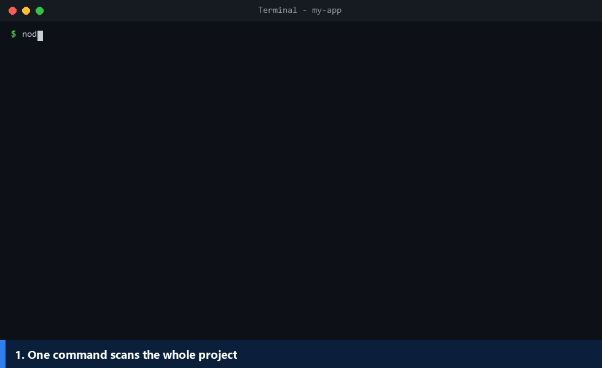
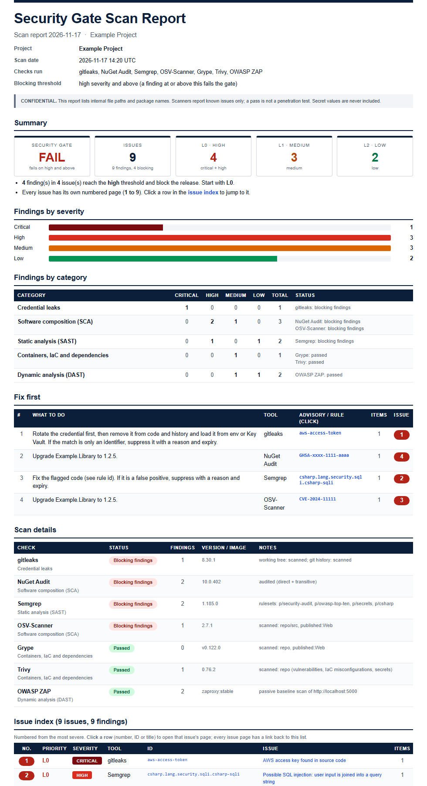

# Security Gate Skill

[](https://github.com/mtalhaamin/Security-Gate-Skill/actions/workflows/selftest.yml)
[](LICENSE)
[](https://github.com/mtalhaamin/Security-Gate-Skill/releases)

**One command that scans your project for security problems and gives you a PDF report.**



Example PDF: [docs/example-report.pdf](docs/example-report.pdf) (made-up data, not a real project)

## What it checks

| Problem | Tool that checks it |
|---|---|
| Passwords or keys left in your code | gitleaks |
| Libraries with known security holes | OSV-Scanner, NuGet Audit, Trivy, Grype |
| Unsafe code patterns | Semgrep |
| Docker images and Dockerfiles | Trivy, Grype |
| A running website (optional) | OWASP ZAP |

At the end you get **PASS**, **FAIL** or **INCOMPLETE**, and a PDF with every problem listed, most serious first.

## What you need (install once)

1. **[Docker Desktop](https://www.docker.com/products/docker-desktop/)**: the scanners run inside it, so you install no scanner yourself.
2. **[Node.js](https://nodejs.org/) 20 or newer**: runs the gate.
3. **[.NET SDK](https://dotnet.microsoft.com/download)**: only if your project uses .NET.

## How to run it (3 steps)

**1. Download it**

```bash
git clone https://github.com/mtalhaamin/Security-Gate-Skill.git
cd Security-Gate-Skill
```

**2. Check your setup** (changes nothing)

```bash
node security-gate/scripts/gate.mjs --preflight
```

**3. Scan your project** (put your own project path)

```bash
node security-gate/scripts/gate.mjs --root "C:\path\to\your-project"
```

- The **first run is slow**: it downloads the scanners (about 600 MB) and their databases. This is normal. Next runs are much faster.
- On Windows, Docker Desktop starts by itself if it is not running.
- Your report is here: **`your-project/.work/security-gate/security-report.pdf`**

## How to read the result

| Result | Meaning |
|---|---|
| **PASS** | Everything ran and nothing serious was found |
| **FAIL** | Something serious was found. Open the PDF |
| **INCOMPLETE** | A tool could not run, so the result is not trustworthy yet. Run the `--preflight` step |

In the PDF, problems are ranked:

| Level | Meaning | What to do |
|---|---|---|
| **L0 High** | Critical or high risk | Fix now |
| **L1 Medium** | Medium risk | Fix soon |
| **L2 Low** | Low risk | Fix when you can |

Every problem has its **own numbered page**. Near the start of the PDF there is an "Issue index" list: **click any row and the PDF jumps straight to that problem.**



## Other things you can do

Add these to the step 3 command:

| I want to... | Add this |
|---|---|
| Check only passwords and keys | `--tool secrets` |
| Check only libraries | `--tool sca` |
| Check only my code | `--tool sast` |
| Scan a Docker image | `--tool container --image myapp:1.0` |
| Scan my website and let the gate start it for me (.NET, Node.js, Django) | `--dast-auto` |
| Scan my website that is already running (your own, on your computer) | `--dast-url http://localhost:5000` |
| Fail on smaller problems too | `--fail-on medium` |

## What happens when you run it (in this order)

1. **Get ready:** checks Docker, downloads the scanners on the first run, and (for .NET) builds your project into a temp folder so the library scanners can read it.
2. **gitleaks:** passwords and keys, in your files and in your git history.
3. **NuGet Audit:** vulnerable .NET libraries.
4. **Semgrep:** unsafe code, using the rules for the languages found in your project.
5. **OSV-Scanner**, then **Grype**, then **Trivy:** vulnerable libraries, Docker images and Dockerfiles.
6. **OWASP ZAP:** last, and only when you ask for it (see below).
7. **Verdict and PDF:** PASS, FAIL or INCOMPLETE, and the report.

Files listed in your `.gitignore` are skipped by every scanner.

**How the OWASP ZAP check works:** ZAP does not read your code. It visits your running website like a browser and looks for weak spots such as missing security headers or outdated scripts. So the site must be running, on your own computer:

- `--dast-auto`: the gate starts your app (.NET, Node.js or Django), scans it, and stops it again. You do nothing.
- `--dast-url http://localhost:5000`: you start the app yourself and give the address.
- By default ZAP only **looks** (passive scan, no attacks). An attacking scan needs `--dast-full --i-am-authorized` and is for apps you own.

## A scary result that looks wrong?

Some alarms are false. For example, long ID numbers can look like passwords. The PDF says "probable false positive" when it suspects this. To hide a false alarm, see **Hiding false alarms** in the [advanced guide](docs/ADVANCED.md).

## Use it inside your AI coding tool (optional)

Works with Claude Code, Cursor, Codex and Antigravity. Install it into your project:

```bash
node install-skill.mjs --agent all --project "C:\path\to\your-project" --agents-md
```

Restart the tool, then just say: **"run the security gate"**.

## Something not working?

| Problem | Fix |
|---|---|
| "Docker is not running" | Open Docker Desktop and wait until it says running |
| Result is INCOMPLETE | Run the `--preflight` step and fix what it shows |
| No PDF was made | You need Microsoft Edge or Google Chrome installed |
| Very slow | Normal on the first run only |

More help, all options, and safety notes: **[docs/ADVANCED.md](docs/ADVANCED.md)**

## Good to know

- A PASS means no *known* problems were found. It is not a hacker-style test.
- Your project is mounted read-only inside Docker, and secret values are never written to the report.
- Tested on Windows. It should also work on Linux and macOS but that is untested.

Want to help? See [CONTRIBUTING.md](CONTRIBUTING.md). Found a security problem in this project? See [SECURITY.md](SECURITY.md).

License: [MIT](LICENSE)
